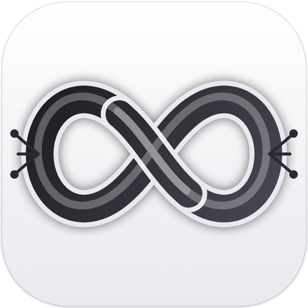
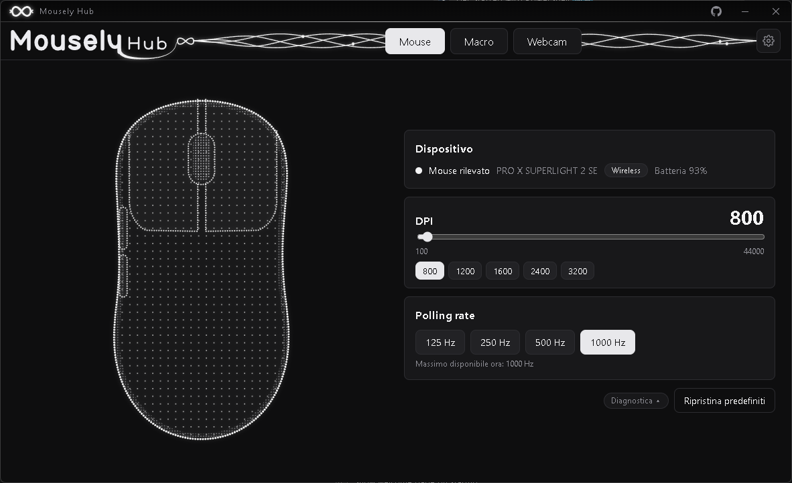
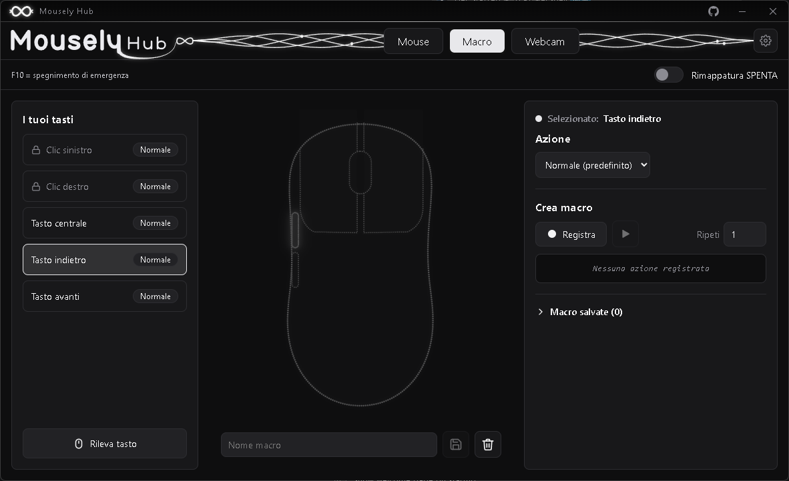
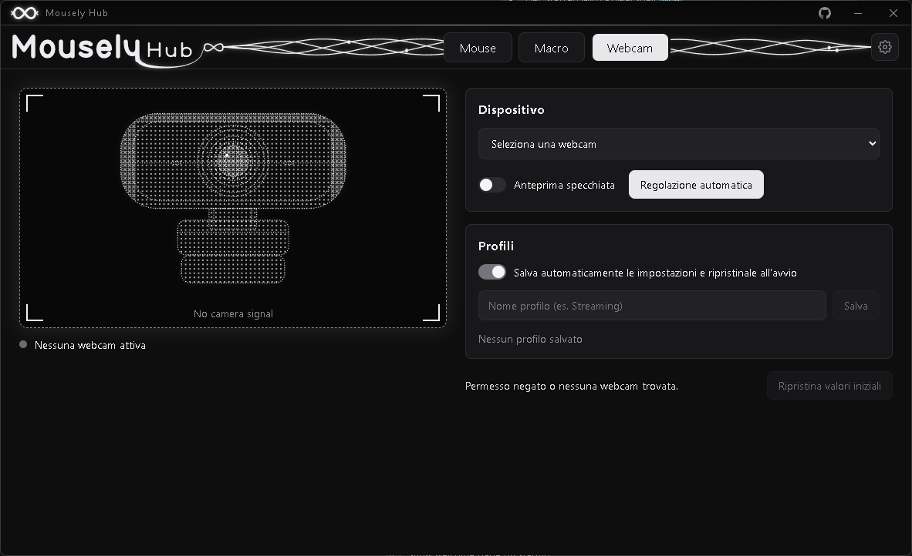
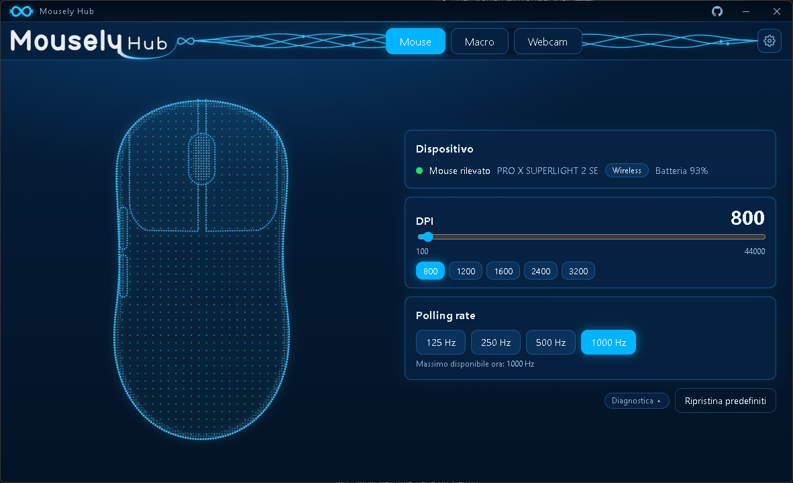
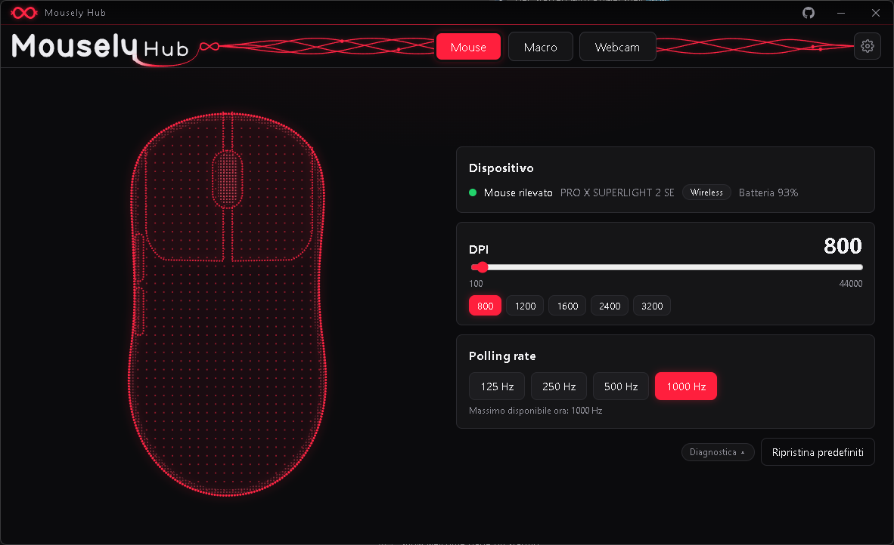

<p align="center">
  
</p>

<h1 align="center">Mousely Hub</h1>

<p align="center">
  See and control your mouse, macros and webcam without the heavy vendor software.<br>
  Free and open source. Light, private, no account.
</p>

<p align="center">
  <a href="https://github.com/WhiteRecon177/mousely-hub/releases/latest"></a>
  
  
  
  <a href="https://github.com/WhiteRecon177/mousely-hub/blob/main/LICENSE"></a>
  
  
  
  <a href="https://github.com/WhiteRecon177/mousely-hub/releases"></a>
  <a href="https://github.com/WhiteRecon177/mousely-hub/stargazers"></a>
  <a href="https://github.com/WhiteRecon177/mousely-hub/issues"></a>
</p>

<p align="center">
  <a href="https://github.com/WhiteRecon177/mousely-hub/releases/latest"><b>Download</b></a>
  &nbsp;·&nbsp; <a href="#getting-started">Getting started</a>
  &nbsp;·&nbsp; <a href="#privacy">Privacy</a>
  &nbsp;·&nbsp; <a href="CONTRIBUTING.md">Contribute</a>
</p>

<p align="center">
  
</p>

## Why Mousely Hub

- **Everything in one small window.** Battery, DPI and polling rate of your mouse, macros and button remapping, webcam controls with saved profiles.
- **Light.** A few MB installer, no background services. Closing the window can keep it quietly in the system tray.
- **Live.** Plug or unplug the cable and the state updates instantly.
- **Private.** No account, no telemetry, no analytics. The only thing the app asks the internet is whether a newer version exists, and you can turn that off.
- **Yours.** Three themes (Monochrome, Ocean Glass, Crimson) and 8 languages: English, Italiano, Español, Deutsch, Français, Português, Русский, 中文.
- **Updates itself.** A small notice tells you when a new version is out, with a one-click update.

## Screenshots

<p align="center">
  
  
</p>
<p align="center">
  
  
</p>

## Download

All files are on the [releases page](https://github.com/WhiteRecon177/mousely-hub/releases/latest).

| System and file | Notes |
|---|---|
| **Windows** · `Mousely.Hub_x.y.z_x64-setup.exe` | Installs for your user only, no administrator rights needed. |
| **macOS** · `.dmg` (Apple silicon and Intel) | Drag the app to Applications. Not notarised: see [docs/PLATFORMS.md](docs/PLATFORMS.md). |
| **Linux** · `.deb` or `.AppImage` | Needs one udev rule to read the mouse: see [docs/PLATFORMS.md](docs/PLATFORMS.md). |

Requirements: Windows 10 or 11 (64-bit, with the Microsoft Edge WebView2 Runtime, already part of Windows 11), macOS 10.15 or newer, or a recent Linux with X11. Windows is the best tested; macOS and Linux are new and button remapping works on Windows only for now. Details in [docs/PLATFORMS.md](docs/PLATFORMS.md).

> **Note:** the installer is not code-signed yet, so Windows SmartScreen may warn you the first time: choose *More info → Run anyway*. The installer is built by GitHub Actions from this source.

## Getting started

1. Run the installer and start **Mousely Hub**.
2. **Mouse** tab: pick your device, see battery, DPI and polling rate. Changes are applied to the mouse.
3. **Macro** tab: record and play macros, remap buttons.
4. **Webcam** tab: adjust brightness, contrast, focus and more, and save profiles.
5. Open the gear in the top right for language, theme, start with the system and updates.

## Supported mice

| Brand | Status |
|---|---|
| Logitech (HID++ 2.0, LIGHTSPEED) | **Working** (tested): DPI, polling rate, battery |
| SteelSeries Aerox 3 / 5 / 9 Wireless | **Experimental**: battery, DPI and polling rate (write) |
| SteelSeries Sensei Ten (cable) | **Experimental**: DPI and polling rate (write) |
| HyperX Pulsefire Dart | **Experimental**: battery, DPI (read and write), polling rate (write) |
| Pulsar X3, X3 LHD (cable) | **Experimental**: battery, DPI and polling rate (read and write) |
| Glorious Model O, O-, D, D- Wireless | **Experimental**: battery and polling rate (write). DPI not yet |
| Pulsar X2 CrazyLight, Feinmann F01 Noctua, Lamzu Maya X 8K, VAXEE, Attack Shark X11 | **Experimental, read-only**: shows what the mouse reports; never changes a setting |
| Other brands and models | Not supported yet: see [docs/DRIVERS.md](docs/DRIVERS.md) |

**Experimental** means the driver is written from public, permissively licensed protocol documentation but **has not been tested on a real mouse by us**. The settings that these drivers write are limited to DPI and polling rate; they never send firmware, DFU, reset, pairing or "save to flash" commands. The research notes (in Italian, unverified, with sources) are in [`docs/PROTOCOLLI.md`](docs/PROTOCOLLI.md).

### Do you own one of these mice? Please test it

That is what turns an experimental driver into a tested one, and it takes two minutes:

1. Install the app and open the **Mouse** tab.
2. Check that the model, battery, DPI and polling rate on screen match the vendor software or the mouse.
3. Try changing the DPI and the polling rate. Does the mouse really change?
4. Press **Diagnostics** and copy the text.
5. Open an [issue](https://github.com/WhiteRecon177/mousely-hub/issues) with the model, the connection (cable or dongle), what worked and what did not, and the diagnostics text. It contains no serial number or personal data.

Mouse support is the main thing missing, and you can help even without writing code: see [CONTRIBUTING.md](CONTRIBUTING.md).

## Privacy

- No account, no telemetry, no analytics. Nothing you do in the app is sent anywhere.
- The only network request is the update check to GitHub Releases (Settings → "Check for updates at start").
- Macros and settings stay on your PC. Keys and mouse buttons are read only while you record a macro or use a remapped button, and never leave the app.
- Because it can read global input (needed for macros and button remapping), some antivirus programs may flag it the first time. The code is open: you can read it or build it yourself.

## Please read

- **Games with anti-cheat** (Valorant/Vanguard, FACEIT, EAC, BattlEye...) may treat macros and remapped buttons as cheating and ban your account. Do not use the Macro tab in online games. You do it at your own risk.
- **Use at your own risk.** The drivers talk to your devices over standard HID. Writing settings is limited to documented commands (DPI and polling rate on the experimental mice), but no warranty is given (see the licence).

## Building from source

Requirements: Windows 10/11, macOS or Linux, [Node.js](https://nodejs.org), [Rust](https://rustup.rs) and the [Tauri prerequisites](https://tauri.app/start/prerequisites/).

```bash
npm install
npm run tauri dev      # run with hot reload
npm run tauri build -- --bundles nsis   # build the installer
```

Built with [Tauri 2](https://tauri.app) (Rust) + React + Vite + TypeScript. How releases and automatic updates work: [`docs/UPDATES.md`](docs/UPDATES.md).

## Support Mousely Hub

Mousely Hub is free, open source and made in my spare time. If it is useful to you, these things help a lot:

- **A star on GitHub**: it costs you a click and helps other people find the project.
- **Test your mouse**: if you own one of the experimental mice, your report turns it into a tested one.
- **Report a bug or suggest an idea** in the [issues](https://github.com/WhiteRecon177/mousely-hub/issues) or the [discussions](https://github.com/WhiteRecon177/mousely-hub/discussions).
- **Share it** with a friend who is tired of heavy vendor software.

<p align="center">
  <a href="https://github.com/WhiteRecon177/mousely-hub/stargazers"></a>
  <a href="#do-you-own-one-of-these-mice-please-test-it"></a>
  <a href="https://github.com/WhiteRecon177/mousely-hub/issues/new"></a>
</p>

## Contributing

Bug reports, mouse data, translations and pull requests are welcome: see [CONTRIBUTING.md](CONTRIBUTING.md).

## Trademarks and independence

Mousely Hub is an independent open-source project. It is **not affiliated with, endorsed by or sponsored by** Logitech, Razer, Corsair, SteelSeries, Microsoft, Glorious, HyperX, Pulsar, Lamzu, Attack Shark or any other brand. All product names, logos and brands are property of their owners and are used only to say which devices are compatible. The interface and logo are original work.

Device support comes from the public HID standard and from the interoperability work of the community. Only facts (ids, byte frames) are taken from projects with a permissive licence (MIT, Apache-2.0, BSD, CC0, WTFPL), and the code is written from scratch. Projects with a copyleft licence are used for description only. Sources and credits are in [THIRD_PARTY_NOTICES.md](THIRD_PARTY_NOTICES.md) and [docs/DRIVERS.md](docs/DRIVERS.md); see also [CONTRIBUTING.md](CONTRIBUTING.md).

## License

[MIT](LICENSE)
